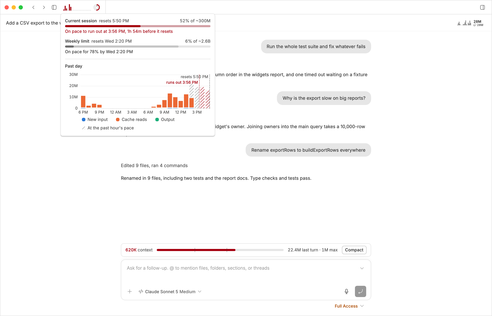

# bb-plugins

Plugins for [bb](https://getbb.app), the agentic IDE.

> bb's secret power is that it's nailed the ergonomics of authoring
> customizations (inline agents and plugin architecture). You can modify bb
> just as easily as modifying whatever codebase you're working in!
>
> From [bb is the bee's knees](https://danielbachhuber.com/bb-is-the-bees-knees/)

## ⚠️ This repository is public

Nothing here may contain a credential, a real private repository or project
name, or any content copied out of a thread. Anything personal is a plugin
setting held in `~/.bb`, never a constant in the source. Test fixtures use
invented names (`acme/widgets`, `octocat`, `Acme Board`) for the same reason.

Nothing under `~/.bb` belongs in this repository either: plugin settings,
secrets, HTTP tokens, and `data.db` all live there and all stay there.

## The plugins

### Published plugins

These are in the bb-community marketplace, released from a `<id>/vX.Y.Z` tag.
Move a plugin here when it is first published.

#### [Automation Palette](https://getbb.app/marketplace/automation-palette)

Run any bb automation from the quick palette, without opening the Automations page.

Source: [`bb-plugin-automation-palette`](bb-plugin-automation-palette)


#### [Diff Viewed Enhanced](https://getbb.app/marketplace/diff-viewed)

Adds a viewed count and GitHub sync to bb's own Viewed checkboxes, so you can see how much of a long diff you've read.

Source: [`bb-plugin-diff-viewed`](bb-plugin-diff-viewed)


#### [Impromptu UI](https://getbb.app/marketplace/impromptu-ui)

Turns your agent's walls of text into interfaces you can click.

Source: [`bb-plugin-impromptu-ui`](bb-plugin-impromptu-ui)


#### [Markdown Editor](https://getbb.app/marketplace/markdown-editor)

Edit markdown files in the tab bb opens them in, preview the result, and save with Cmd+S without overwriting an agent's edits.

Source: [`bb-plugin-markdown-editor`](bb-plugin-markdown-editor)


#### [Tokenomics](https://getbb.app/marketplace/tokenomics)

See what your threads cost in tokens and time, and whether your subscription's session and weekly limits will last until they reset.

Source: [`bb-plugin-tokenomics`](bb-plugin-tokenomics)



### Unpublished plugins

These are installed from this checkout only, not from the marketplace.

| Directory | bb id | What it does |
| --- | --- | --- |
| `bb-plugin-contributor-dashboard` | `contributor-dashboard` | A dashboard of how people contribute to one GitHub repository, from a local mirror of its pull requests, reviews, issues and releases; it opens with a flow diagram of the delivery stages, showing what is waiting in each step and where everything opened in the period went, including skipped reviews and work sent back, then an Issues and a Pull requests section time each step with the median, p75 and p90 and chart, for everyone and per person, the pull requests opened and merged and the reviews requested and given, with the work that bled into a later week, over a preset span or a range of dates you pick, and ends with each GitHub release's pull requests by kind, its patches, and who merged and reviewed them; a step, a name, or a section heading opens its own page, and every row in a list names its assignee and starts a thread on it. |
| `bb-plugin-dev-bar` | `dev-bar` | A status bar under a thread that starts, stops, and restarts its checkout's dev services, and stops them when its last thread is archived. |
| `bb-plugin-diff-comment` | `diff-comment` | Leave review comments inline on a thread's diff, then have the agent work through them one at a time. The agent can offer the points it raises in a review as comments to add, the thread's pull request review comments show on the same diff, and any comment can go to the pull request as a draft review comment. |
| `bb-plugin-gh-context` | `gh-context` | A banner above the composer showing the thread's pull request and its reviewers, the GitHub issues it works on, its changes, and a Harvest timer, in place of bb's own. |
| `bb-plugin-hacks` | `hacks` | Local patches to bb's own UI, each one standing in for a fix that has not landed upstream yet. Currently: remembers the changes panel's stacked/split view mode and line-wrap toggle across reloads, remembers each thread's range (such as Uncommitted changes) when you switch away and back, opens the unread files bb folds away in a large diff, adds a button to each sidebar project that opens its checkout in your editor, shows whether each project's checkout is behind origin and pulls it on click, then runs its sync script, and starts diff code blocks in chat wrapped. |
| `bb-plugin-harvest` | `harvest` | Connects bb to Harvest so other plugins can start and stop timers on GitHub issues and pull requests. |
| `bb-plugin-issue-sweep` | `issue-sweep` | Open GitHub issues assigned to you, split into what needs you and everything else grouped by board status, with local notes, an On hold box that sinks an issue to the bottom, new comment counts, and the comments a click away. Clicking the sync time shows what the past hour of sweeps cost against GitHub's rate limit. Needs gh-context. |
| `bb-plugin-new-issue` | `new-issue` | Draft a GitHub issue from a few lines of notes, in a thread that runs the draft-issue-description skill. |
| `bb-plugin-now` | `now` | One list of what needs doing now, from Todoist and your Gmail inbox, with GitHub notifications gathered per pull request or issue, showing each pull request's reviewers, and Google Docs comments per document. Overdue tasks, and mail left in the inbox more than a day, are tinted red and say how late they are. A square per row above the list shows how Now splits into urgent (overdue tasks and Todoist's Inbox), unread email, today, your own items and email to you, requests of you, what can be archived, and what is minor, and pressing a run shows only its rows. Todoist descriptions render as Markdown, with open subtasks listed beneath. Complete, rename, describe, reschedule, postpone, reprioritize, move, or delete tasks, read an email in full beside the list, open an email or GitHub comment the snippet cut short in full, archive email or mark it read, answer calendar invitations, accept a new time a guest proposes for your event, reply on GitHub, merge your own pull requests, and start a thread from any row. Clicking the sync time shows the past hour's calls to Todoist, Gmail, Calendar, and GitHub, sync by sync. A column beside the list shows the week's priorities, written in by Weekly Review from your journal, with the hours each has had, and you check each one off there. Its icon in bb's navigation shows the urgent count in red, or the due-today count in amber. |
| `bb-plugin-plugin-shelf` | `plugin-shelf` | Lists the plugins in your bb-plugins checkout as published and current, published with commits not yet released (with those commits), or personal, with each published plugin's install count, on a My plugins page in bb's Plugins screen, with a button on each to start a thread on it and one to publish an update where one is due. |
| `bb-plugin-presentations` | `presentations` | Give a talk from a bb thread: the agent writes the slides as numbered markdown files, and a Present button shows them beside the chat with each file listed for editing, a full-screen mode, and a separate window for the projector, styled by the deck's own `style.css` when it has one. |
| `bb-plugin-pr-sweep` | `pr-sweep` | Open pull requests you authored in one list, newest first with in-progress ones on top and those waiting on others closed to one line at the bottom, with local notes, new comment counts, review comments a click away, a Dismiss for failing checks you cannot fix, and where a stacked pull request sits in its stack. Clicking the sync time shows what the past hour of sweeps cost against GitHub's rate limit. Its icon in bb's navigation shows how many need you, in red. Needs gh-context. |
| `bb-plugin-review-sweep` | `review-sweep` | Open pull requests waiting on a review from you in one list, ordered Now, Next, and Later by what needs you, oldest request first, with local notes, new comment counts, comments a click away, and where a stacked pull request sits in its stack, a Snooze that sinks a request to one line until a day you pick, plus Batch to start reviews for several at once. Clicking the sync time shows what the past hour of sweeps cost against GitHub's rate limit. Its icon in bb's navigation shows how many have waited too long, in red. Needs gh-context. |
| `bb-plugin-super-diff` | `super-diff` | Group the Diff tab by concern, with an explanation for each group and notes on tricky code, plus a note on any line you ask about. |
| `bb-plugin-weekly-review` | `weekly-review` | One page of what you actually did this week, gathered at 7am and 1pm on weekdays, sorted into workstreams by rules you refine, and set against the priorities in last week's entry, to write the journal entry from. It sends those priorities to the Now page, with each one's hours, and shows which you checked off there. A skill writes up the work of any thread as a journal entry in the same format, and adds it to the doc once you have edited and accepted it. Another drafts last month's wins from the journal into your wins doc. |

### Retired plugins

A plugin whose `package.json` sets `"bbPlugins": {"status": "retired"}` is
kept for reference only. It is not in the marketplace, and `setup.sh` and
`sync.sh` leave it out of bb; `sync.sh` says so when bb still has one
installed. `"ignored"` skips a plugin the same way, for one that should not
be installed on every machine yet.

| Directory | What it was |
| --- | --- |
| `bb-plugin-super-diff-v1` | The first Super Diff: an agent grouped a branch's hunks into concerns, with a checkmark per hunk and test changes shown as Gherkin scenarios. Replaced by `bb-plugin-super-diff`. |
| `bb-plugin-thread-overview` | A band under each thread's header saying what the thread is for, what has been done so far, and which step it is on, written by the agent as it works and edited by you in place. Deprecated for now. |
| `bb-plugin-thread-todos` | Forwarded bb todo and the todo tools to Thread Overview for threads started before it replaced this plugin. Deprecated for now, along with Thread Overview. |

`gh-shared` is not a plugin. It is the `gh` runner and project matching that
the three sweeps share, pulled in as a `file:` dependency and bundled at build
time, so an edit there needs all three rebuilt. The sweeps deliberately do not
share their classifiers or fetch strategies: those genuinely differ, and an
earlier attempt to merge the three into one plugin was reverted.

`component-library` is not a plugin either. It holds UI that several plugins
draw the same way, such as the sync status in a page's title bar, with a
story for each state and a section in its README on how each piece is used.
Plugins install it as `@danielbachhuber/bb-plugin-component-library` rather
than keeping their own copies, so an edit there needs every plugin that uses it
rebuilt. It is published to npm, because a plugin installed from the
marketplace cannot reach a sibling directory's dependencies; in this checkout
npm links the local copy.

`bb-plugin-harvest` is also a `file:` dependency of the three sweeps, which use
its timer components to draw a clock on each row.

`bb-plugin-gh-context` is a `file:` dependency of the three sweeps too, and a
plugin they need installed. It holds the one record of which threads belong to
which issues and pull requests; the sweeps read and write it through
`bb-plugin-gh-context/links` rather than each keeping a table of their own.

## Setting up

`.bb/plugins.json` indexes the plugin directories so one checkout can serve
them all. `setup.sh` installs every one of them:

```sh
./setup.sh
```

bb loads them as `path:` sources pointing straight at the directories here, so
an edit is live after a rebuild. `sync.sh` does that rebuild for whatever has
drifted:

```sh
./sync.sh --check   # report what is stale, change nothing
./sync.sh           # install, typecheck, build, and reload it
```

`sync.sh --check` is fast and offline, which makes it suitable for a
`post-merge` hook.

`sync.sh` builds with the Node version in `.nvmrc`, loading it through nvm, and
stops if that version is not installed. Different npm versions write
`package-lock.json` differently, so building with another Node leaves the
lockfile modified. It installs a plugin that bb has not seen yet, so one that
arrives in a pull is enabled on the next run. To keep one off a machine, run
`bb plugin disable <id>`: `sync.sh` leaves a disabled plugin disabled. It also
removes a plugin that has been deleted from `origin/main`, along with that
plugin's settings and secrets. A plugin that is only missing from the current
branch stays installed.

Each machine keeps this checkout current with the "Update projects" automation
in `danielbachhuber/dotfiles` (`bb/automations/update-projects.sh`). It
fast-forwards `main` from `origin` and runs `sync.sh` when `sync.sh --check`
reports drift. A checkout on another branch or with uncommitted changes is left
alone.

## Working on one plugin

```sh
cd bb-plugin-<name>
npm install                           # installs every workspace, from the root
npx tsc --noEmit -p tsconfig.json
npm test
node ../scripts/link-workspace-deps.mjs && bb plugin build . && bb plugin reload <id>
```

`tsc --noEmit` is what catches a plugin that no longer fits a shared library it
links, a failure that otherwise reaches the panel as a runtime
"is not a function".

## Stories

Plugin UI can be worked on in [Ladle](https://ladle.dev), the story viewer bb
uses for its own components, without building or reloading a plugin:

```sh
npm run storybook          # http://localhost:61000
npm run storybook:build    # static build in build/
```

Stories are `*.stories.tsx` files in any plugin directory. They render inside
bb's own story wrapper, with bb's stylesheet and theme toggle, and can import
bb's components through `@bb-app/...` to show a plugin's UI beside the part of
bb it sits next to.

That requires a bb checkout with its dependencies installed. The scripts look
for it at `~/projects/bb`; set `BB_SOURCE_DIR` in `.env` (see `.env.example`)
if it is somewhere else. They run the Ladle, Vite, and Tailwind bb already has
installed, and a checkout whose `node_modules` is older than its source fails
on whichever package it is missing. Run `pnpm install` in bb when that happens.

`npm run screenshots` captures the stories outside an `explore/` directory in
the light theme and commits the
images to a separate checkout of `bb-plugins-screenshots`, so there is a
visual history of each plugin without images in this repository's history.
It also writes that repository's READMEs: a table of the plugins, and a page
per plugin with its description and every story, captioned with the comment
above the story. It lists the files that changed without committing them;
`npm run screenshots:commit` commits and pushes them once you have checked
them for anything private. `npm run screenshots:isolated` does the same in a
temporary build directory and a new worktree of that checkout, so threads
capturing at the same time do not collide, and prints the commit command for
that worktree. Both capture up to ten stories at once, leaving two CPU cores
free; set `SCREENSHOTS_CONCURRENCY` to change the number. Add `-- --explore`
to include the `explore/` stories, for when you want pictures of design
options; those images are not meant to be committed. A run captures only the
stories that import a file changed since the bb-plugins commit that checkout
last captured, and keeps the other images as they are; add `-- --all` to
capture every story. Add `-- --plugin <name>`, such as `-- --plugin tokenomics`
or `-- --plugin bb-plugin-tokenomics`, to capture only that plugin's stories and
rewrite only its README and its row in the root README, leaving other plugins'
changes for their own captures. Repeat it to name several. It
needs `npm install`, which installs Playwright with everything else, and that checkout at
`../bb-plugins-screenshots` or at `BB_PLUGINS_SCREENSHOTS_DIR` in `.env`.

To photograph a few stories, such as design options in `explore/`, without
building or touching that checkout:

```sh
npm run screenshots -- --story 'pr-sweep--pr-list--*' --out /tmp/options [--theme dark]
```

`--story` takes a story id or a glob over ids and can be repeated. Each image
is written to `<out>/<story id>.png`. It uses a running `npm run storybook`
server for this checkout, or starts one for the run, so it takes seconds
rather than a build. A story that throws, or that Vite cannot load, stops the
run at once with the error and a non-zero exit.
