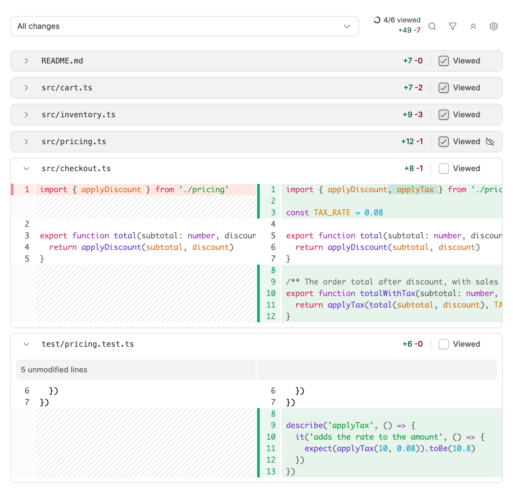

# Diff Viewed Enhanced

Adds a viewed count and GitHub sync to bb's own Viewed checkboxes, so you can see how much of a long diff you've read.


## Key features

### A viewed count in the changes panel toolbar

Open the changes panel (⌘ D) and check **Viewed** on the files you have read, using bb's own checkbox in each file header. The toolbar counts them, such as **3/6 viewed**, across the whole range, including files you have not scrolled to. The ring beside the count fills as you go and turns green when every file is viewed.

### Viewed marks shared with the pull request



When the thread has an open pull request, checking a file in bb marks it viewed on GitHub, and a file you mark viewed on GitHub is checked in bb. A file whose diff in bb differs from GitHub's, such as one with edits you have not pushed, shows a crossed-out cloud for **Local**: its mark stays in bb and goes to GitHub once a push makes the diffs match.

## Settings

| Setting | Default | What it does |
| --- | --- | --- |
| `syncGithub` | `on` | Share Viewed marks with GitHub's Viewed boxes. Set to `off` to keep them in bb only. |
| `ghPath` | `gh` | The `gh` CLI used for GitHub calls. |

## Requirements

bb 0.47 or later, which has the Viewed checkbox. GitHub sync needs `gh` signed in (`gh auth login`). Opening the changes panel, returning to the window, and checking a file each sync once; a sync makes at most one GraphQL query for the pull request's files, reused for 30 seconds, plus one mutation for each file whose mark changed in bb.

## Related plugins

_As of October 24, 2026_

- **[Guided Review](https://getbb.app/marketplace/guided-review)** (`guided-review`): turns a GitHub pull request or a local Git range into chapters to read, with its own viewed tracking, notes, and a review to submit. Diff Viewed Enhanced adds to bb's own changes panel, and needs no agent provider.
- **[Diff Explorer](https://getbb.app/marketplace/diff-explorer)** (`diff-explorer`): every changed file in one scroll, with go to definition. It is a separate view of the diff; Diff Viewed Enhanced works in bb's changes panel.
- **Diff Comment** (`diff-comment`), in this repository: leave review comments inline on the same changes panel for the agent to work through. Diff Viewed Enhanced tracks what you have read; Diff Comment records what you want changed.

## Develop

```sh
npm install
npx tsc --noEmit
npm test
bb plugin build . && bb plugin reload diff-viewed
```
