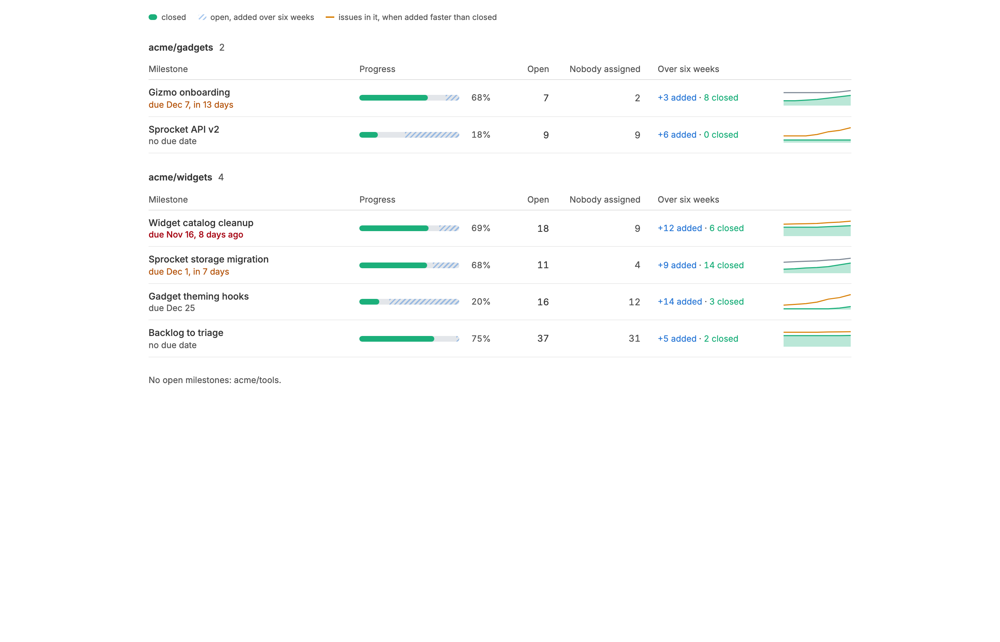
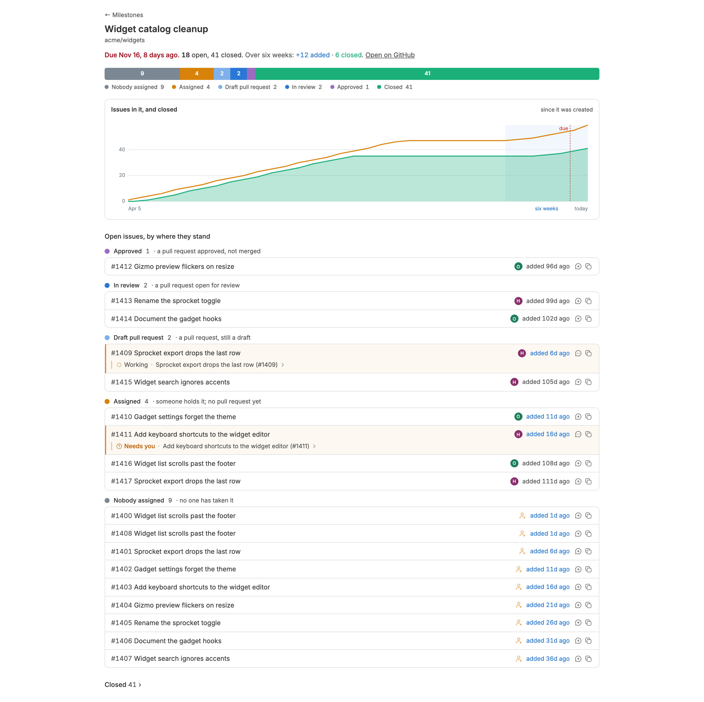

# Milestone Sweep

Every open GitHub milestone in the repositories checked out here: how far along each is, and where each of its issues stands.



## Key features

### A Milestones page in the sidebar

Each repository with open milestones gets a table, due soonest first. A row shows when the milestone is due, in amber when it is close and red when it is late, a bar of how much is closed with the issues added over the period hatched at the end, the open issues and how many have nobody assigned, and how many were added and closed over the period. The small chart turns amber when issues are arriving faster than they close. Repositories with no open milestones are named at the bottom.

### One milestone's page



Clicking a row opens the milestone. A strip shows its issues from **Nobody assigned** to **Closed**, and a chart shows the issues in it and how many had closed, week by week, since it was created. Below that, the open issues are grouped by where they stand: **Approved**, **In review** or **Draft pull request** from the open pull requests that close them, then **Assigned** and **Nobody assigned**. **Closed** opens the closed issues. Each issue links to GitHub. Opening the page again from the sidebar returns to the milestone last shown there, and **Milestones** goes back to the list.

### A thread from any issue

Each issue shows who it is assigned to, or an orange icon when nobody is, and two buttons. **Start a thread** opens bb's composer under the row, set to the project checked out from the repository, with a prompt naming the issue. Once the thread starts, the row gets an orange edge and a line saying what the thread is doing, and the button opens it. **Copy link** copies the issue's title and link.

## Settings

| Setting | Default | What it does |
| --- | --- | --- |
| `syncIntervalMinutes` | `30` | How often it reads the milestones from GitHub. |
| `periodWeeks` | `6` | How many weeks back "added" and "closed" count. |
| `extraRepositories` | blank | More `owner/name` repositories to list, comma or newline separated. |
| `ghPath` | `gh` | The `gh` CLI to run. |

## Requirements

The `gh` CLI, signed in. It lists every repository that a bb project on this machine has as a git remote, plus the extra ones. Each sync makes one GraphQL call per repository, plus one per hundred issues in each milestone that has any, which is about 14 points of GitHub's 5,000-point hourly budget per hundred issues. The sync time in the page's header opens what the past hour of syncs cost. Starting a thread makes no GitHub call. It keeps only the milestones from the last sync, and deletes a milestone's row once it closes or its repository is no longer listed. It remembers which thread each issue's row started until that thread is archived or deleted, checking the threads bb still has each time the plugin starts.

## Related plugins

_As of November 25, 2026_

No plugin in the marketplace or bundled with bb lists GitHub milestones. In this repository:

- **Contributor Dashboard** (`contributor-dashboard`): draws the same milestone table and milestone page for one repository, among its other sections. Milestone Sweep shows only milestones, for every repository checked out here, and reads GitHub itself rather than the dashboard's mirror.
- **Issue Sweep** (`issue-sweep`): the open issues assigned to you. Milestone Sweep uses the same rule for which repositories to read.

## Develop

```sh
npm install
npx tsc --noEmit
npm test
bb plugin build . && bb plugin reload milestone-sweep
```
