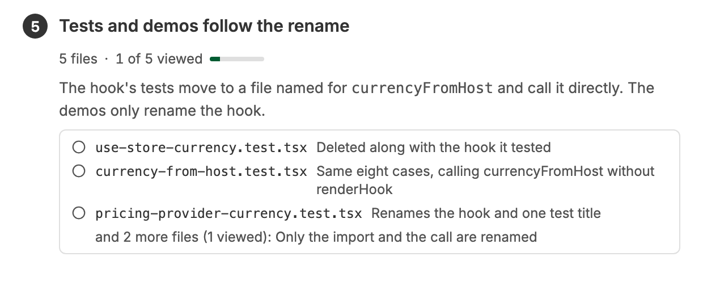
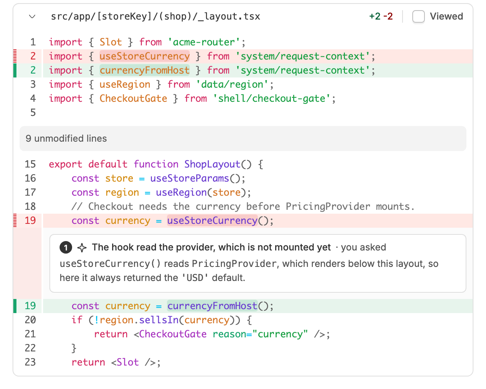
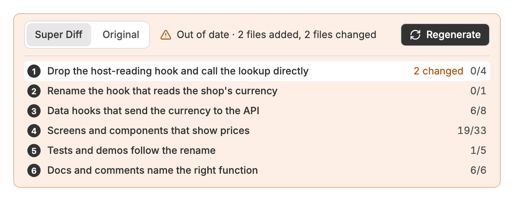

# Super Diff

Group a thread's diff by concern in the Diff tab, with an explanation for each group and notes under the lines that need them.


## Key features

### Concerns in place of the file list


Open a thread's **Diff** tab and click **Generate Super Diff**. The thread's agent reads the diff and groups the changed files into concerns, each with a title and a short explanation, and the grouped list takes the place of bb's file list. The row above it lists every concern with how many of its files you have checked **Viewed**, and clicking one jumps to it. **Super Diff | Original** switches back to bb's own list at any time.

### What each file's change does



Under each concern's explanation is a list of its files, each with one line on what its change does. Files that change the same mechanical way, such as an import rename, share a line. Clicking a file scrolls to its card, which has bb's **Viewed** checkbox and keeps the same marks as bb's own list.

### Notes under the lines that need them



The agent writes a note for each line a reviewer might misread, and the note sits in the diff under that line, removed lines included. Each concern lists its notes, and clicking one jumps to it. To ask about any other line, hover it and click the sparkle beside its line number, **Explain this line**. A hidden side chat of the thread writes the note, so the thread's agent is not interrupted.

### A warning when the diff moves on



When files join the diff or are edited after the Super Diff was written, the row turns amber and offers **Regenerate**. New files show under **Not yet grouped**, and an edited file is marked **changed** in its concern.

## For agents

The `super-diff` skill tells agents to run `bb super-diff read` and follow the guide it prints. An agent can also write a Super Diff at the end of its own work, without anyone pressing Generate.

```sh
bb super-diff read                  # the guide, every changed file, and their patches, in one go
bb super-diff guide                 # how to write a Super Diff
bb super-diff files                 # every changed file, and which ones the plugin places itself
bb super-diff patch <path>...       # the patches for those paths
bb super-diff submit <file | json>  # check a Super Diff and store it if every file is placed once
bb super-diff explain <file | json> # in an Explain this side chat: store its one note
```

`read`, `files`, `patch`, and `submit` take `--target all|uncommitted|committed` to choose the diff.

## Requirements

A thread with a git environment, and bb 0.47 or later for the **Viewed** checkboxes. Nothing calls GitHub. Generate and Explain this each send one message to an agent, then check for the result every 2 seconds. While the Diff tab is open and the window is in front, Super Diff checks every 2 seconds for one an agent stored from the command line. Showing a Super Diff reads the diff from bb: one request for the file list, one per 50 files for patches, and one for the Viewed marks, which it reads again when the window regains focus.

## Related plugins

_As of October 26, 2026_

- **[Guided Review](https://getbb.app/marketplace/guided-review)** (`guided-review`): organizes a GitHub pull request into chapters to read, with notes, an assistant, and a review to submit. Super Diff works on a thread's own diff in bb's Diff tab, before there is a pull request.
- **[Diff Explorer](https://getbb.app/marketplace/diff-explorer)** (`diff-explorer`): every changed file in one scroll, with go to definition. It shows the diff in file order in its own view; Super Diff regroups it by concern in the Diff tab.
- **[Diff Viewed Enhanced](https://getbb.app/marketplace/diff-viewed)** (`diff-viewed`): a viewed count and GitHub sync for bb's Viewed checkboxes. It counts and syncs the checkboxes on Super Diff's cards too.
- **[Code Review](https://getbb.app/marketplace/code-review)** (`code-review`): runs your review skills over a pull request waiting on you and shows the findings beside the code. It reviews for you; Super Diff arranges a diff so you can read it yourself.
- **Diff Comment** (`diff-comment`), in this repository: review comments on the lines of a thread's diff. Its comments work on Super Diff's cards as on bb's.

## Develop

```sh
npm install
npx tsc --noEmit
npm test
bb plugin build . && bb plugin reload super-diff
```
