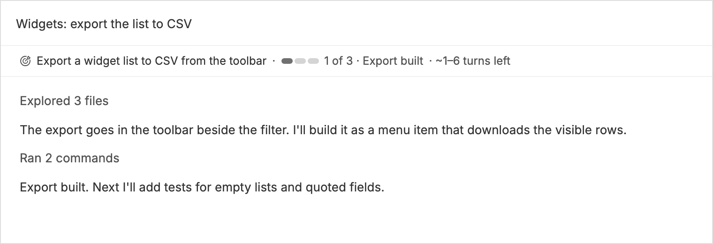
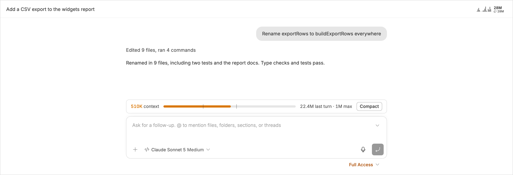
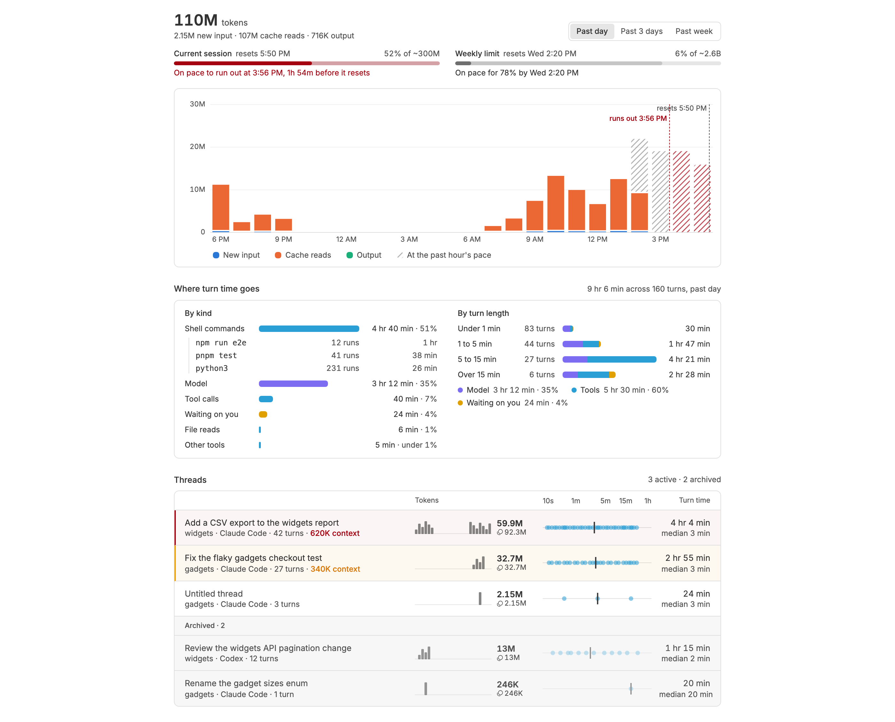

# Tokenomics

See what your threads cost in tokens and time, each thread's goal and its progress, how turns compared with forecasts, and if limits last.


## Key features

### Tokens in each thread's header


Each thread's header shows a sparkline of its tokens over time, its tokens in
the past day in bold, and its lifetime total under them. Click it to see which
of your messages used the most tokens and time, and the thread's three
biggest turns.

### Each turn's time, tokens, and commands


Under each finished turn, a line shows how long it took, its tokens, and the
commands and other tools it ran. Above the composer, a strip counts the
running turn while it runs; its tokens arrive when it ends. bb has no plugin
slot under a turn, so the lines read bb's page markup and stop appearing if
bb changes it. Both read Tokenomics' own database, with no calls to bb.

### Claude's forecast for each turn


Claude forecasts each turn that uses a tool with `bb tokenomics forecast`: an
80% range of model calls, plus any wait it knows of, run alongside its first
command so it costs no extra call. Minutes follow from calls at the thread's
own time per call, and tokens from calls, the context, and how fast the
context has been growing. The line
under the turn shows each number against its range, amber when over and blue
when under, and the strip above the composer counts calls against the range
while the turn runs, turning amber once it passes. The turn's card names its
model, fast mode, and reasoning level. Each forecast prints Claude's recent
record for turns with the same settings, so its next range can move.

### Each thread's goal



Each thread records one goal: what the whole thread is for, not its next
step. In its first turn Claude records it with `bb tokenomics goal set`, from
the brief a plugin or another thread wrote, or from your first prompt, and
says so in one line instead of asking. A task gets 1 to 4 stages, 5 at most,
each an end state such as "Tests pass" rather than a step, and the last one
what ends the thread, such as "PR open with checks passing"; an exploration
gets the question it answers; a conversation can have no goal.

The goal, a segment per stage, the stage reached, and the turns left show in
a band between the thread header and the conversation, which scrolls under
it, so the goal stays in view. A mark such as "1/3" or a check sits beside
the thread's title in the sidebar. Rest on the band for the stages and what the goal has used
against Claude's estimate of its turns, tokens, and minutes. When setting a
goal, Claude sees how past threads that started the same way went, from a
plugin's button, another thread, or neither. Run `/tokenomics-set-goal` to
change a goal: it proposes the new goal and why above the composer, and keeps
the old one, and what it used, in the thread's history. When the work is
done, Claude closes the goal as met, partly met, or not met. Work you review,
such as a design, ends with your acceptance as its last stage, and feedback
that arrives after the goal closed reopens it. A closed goal keeps counting the
thread's turns until another goal replaces it, so follow-up work after the
close counts toward the outcome.

The band and the sidebar mark go into bb's own markup, since bb has no slot
for either. If bb changes that markup they stop appearing, and
nothing else breaks.

### A context meter above the composer



Every model call reads the whole context again, so a large context makes
every turn expensive. Once a thread's context passes 300K tokens, a meter
shows above the composer, amber and then red past 550K. Click **Compact** to
have bb compact the thread. The sidebar counts these threads in amber and red.


The meter also shows, tinted amber, once a thread of 100K tokens or more has
sat idle past its prompt cache, usually an hour for Claude Code. Its next
message would read the whole context again uncached, so that is the moment
to **Compact**. This is the same rule as bb's **Compact before resuming
expired sessions** experiment, which offers to compact as you send. With
both on, both show.

### Your session in the title bar


bb's title bar shows your session as a spark chart of its tokens per 15
minutes from its start to its reset, with a dot for each 15 minutes still to
come, and two rings for the percent used, the session outside and the week
inside. Between sessions, when the provider reports no session, it shows
the week's ring and the past five hours' tokens instead. It sits at the right edge of the sidebar column while the sidebar
is open. When the sidebar is too narrow for the chart, only the rings show.
While the sidebar is closed, it is hidden. It turns amber or red once either is
headed for its limit. Hover it for the limits and the past day's tokens per hour, or click it
to open the page.

### The Tokenomics page



Open **Tokenomics** in the sidebar. Meters for each usage limit show the
percent used of about how many tokens the limit holds, and where it lands at
the current pace, such as "On pace to run out at 3:56 PM, 1h 54m before it
resets". Switch between **Past day**, **Past 3 days**, and **Past week** to
chart tokens split into new input, cache reads, and output. **Where turn time
goes** splits turns into the model's time, tools, and waiting on you, and
names the slowest shell commands. The thread list ranks threads by tokens,
with each one's context size and a dot per turn for its length. **Goals**
shows the past 30 days: how many goals were met, partly met, and not met and
what each took, how often goal estimates held, and archived threads with a
goal against without, by how they started.

## For agents

`bb tokenomics` prints the same numbers, so an agent can find expensive
threads without reading their transcripts.

```sh
bb tokenomics threads [--days N] [--sort tokens|time|context] [--limit N] [--active] [--json]   # tokens, turns, context, and turn times per thread
bb tokenomics commands [--days N] [--limit N] [--json]                                         # the shell commands that took the most time
bb tokenomics forecast --calls LOW-HIGH [--wait-minutes LOW-HIGH] [--note TEXT]                # record this turn's forecast
bb tokenomics forecasts [--days N] [--json]                                                    # past forecasts against what each turn took
bb tokenomics goal set "GOAL" --stage "END STATE" ... [--turns 3-8 --tokens 5M-20M --minutes 20-60]  # record this thread's goal
bb tokenomics goal stage next|N                                                                # mark stages done
bb tokenomics goal estimate [--turns ...] [--tokens ...] [--minutes ...]                         # replace the estimate
bb tokenomics goal add-stage "END STATE"                                                        # add the stage that ends the thread
bb tokenomics goal close met|partly|not [--note TEXT]                                            # record how it ended
bb tokenomics goal reopen [--stage "END STATE"] ...                                              # open a closed goal again, such as for feedback
bb tokenomics goal show [--json]                                                               # the goal, its stages, and what it has used
```

The plugin ships the `tokenomics-set-goal` skill, which drafts a new goal,
asks above the composer, and records it with `--reason`.

The [self-improve-bb](https://github.com/danielbachhuber/skills/tree/main/skills/self-improve-bb)
Claude Code skill uses `bb tokenomics threads` to pick which of the past
week's threads to review.

## Settings

| Setting | Default | What it does |
| --- | --- | --- |
| `contextWarningAt` | `300K` | Shows the context meter in amber once a thread's context passes this many tokens. Empty turns it off. |
| `forecastTurns` | on | Adds about 200 tokens to each thread's instructions asking Claude to forecast each turn. Off stops new forecasts. |
| `contextErrorAt` | `550K` | Turns the meter and the page's row red past this many tokens. Empty leaves only the warning. |
| `setGoals` | on | Adds about 450 tokens to each thread's instructions asking Claude to record, move, and close the thread's goal. Off stops new goals. |
| `goalLine` | on | Shows the goal band above the conversation of a thread with a goal. Off removes it from open threads right away. |
| `goalSidebar` | on | Shows the goal mark beside sidebar rows. Off removes them right away. |

## Requirements

bb 0.43 or later, and a provider that reports token usage to bb. Usage limits
need a provider that reports them, such as Claude Code or Codex. No account or
outside service.

- Tokenomics counts tokens, not dollars.
- It counts a turn's model calls from the context bb records after each response, and keeps each forecast, about 100 bytes, with the thread's other rows.
- It keeps each goal, and each earlier goal a revision replaced, with what it
  used, a few hundred bytes each, and deletes them when bb deletes the
  thread. The band reads one goal from the plugin's database
  when the thread opens and after each turn; the sidebar reads every active
  thread's goal in one request after each recorded usage. Neither asks bb.
- bb deletes a thread's older usage events, so Tokenomics keeps its own copy,
  starting when you install it.
- Claude Code subagents report no usage to bb, so Tokenomics reads their
  transcripts from disk. It counts them only for threads that ran on the
  machine bb runs on. It reads them when the parent thread records usage,
  and every 15 seconds while they are still writing, which is a directory
  listing with no request to bb.
- It reads the usage limits from bb every five minutes, one request that bb
  passes to each provider. Opening a thread's summary reads that thread's
  turn events from bb. The page, title bar, and meter read the plugin's own
  database.

## Related plugins

_As of November 18, 2026_

- **[Burn](https://getbb.app/marketplace/burn)** (`burn`): shows what each thread costs in dollars, per prompt and
  across threads, with budgets. Tokenomics counts tokens rather than dollars,
  and adds turn time, context size, and usage limits.
- **[Usage Meter](https://getbb.app/marketplace/usage-meter)** (`usage-meter`): shows Claude subscription limits as two
  rings in the sidebar footer and reads Claude Code transcripts to explain
  where they went. Tokenomics reads bb's usage events, so it covers any
  provider that reports usage to bb, and breaks usage down by thread and by
  hour.
- **[Receipts](https://getbb.app/marketplace/receipts)** (`receipts`): breaks token use and estimated cost down by
  model, project, and day. Tokenomics breaks it down by thread and by hour,
  with no cost estimates.
- **[Provider usage](https://getbb.app/marketplace/provider-usage)** (`provider-usage`), bundled with bb, **[Usage Bar](https://getbb.app/marketplace/usage-bar)**
  (`usage-bar`), and **[Usage Limits](https://getbb.app/marketplace/usage-limits)** (`usage-limits`): show each provider's
  quota windows and when they reset. **[Usage Pace](https://getbb.app/marketplace/usage-pace)** (`usage-pace`) adds
  whether your current rate lasts until each reset. Tokenomics reads the same
  limits, estimates how many tokens each holds, and draws where each is
  headed on its token chart.
- **[Auto Compact](https://getbb.app/marketplace/auto-compact)** (`auto-compact`): compacts a thread on its own once its
  context reaches a share of the window. Tokenomics warns at a token count you
  set and leaves compacting to you.
- **[Cache Watch](https://getbb.app/marketplace/cache-watch)** (`cache-watch`): shows how much
  prompt cache each turn reuses, the time left before it expires, and an
  optional keepalive that sends turns to keep it warm. Tokenomics only says
  once an idle thread's cache has expired, and offers to compact.
- **[Context Meter](https://getbb.app/marketplace/context-meter)** (`context-meter`) and **[Context Katamari](https://getbb.app/marketplace/context-katamari)**
  (`context-katamari`): show how full one thread's context is. **[Context
  Health](https://getbb.app/marketplace/context-health)** (`context-health`) shows what makes it up. Tokenomics shows each
  thread's context size beside its token use over time, across all threads.

- **[UltraGoal](https://getbb.app/marketplace/ultragoal)** (`ultragoal`) and **[Loom](https://getbb.app/marketplace/loom)** (`loom`): take a goal
  and run it across workers, with plans, tickets, and verifiers. Tokenomics
  only records each thread's goal, shows its stage, and counts what it cost.
- **[Plan Progress](https://getbb.app/marketplace/plan-progress)** (`plan-progress`): follows the agent's plan above the
  message box, step by step. Tokenomics shows the goal and its stage, at
  most five end states, never the step list.
- **[Radar Sidebar](https://getbb.app/marketplace/radar-sidebar)** (`radar-sidebar`): replaces the sidebar, groups
  threads by activity, and previews goals on hover. Tokenomics leaves bb's
  sidebar in place and adds a mark beside each row.
- bb's own thread goal, for Codex threads, keeps an objective and a token
  budget per thread. Tokenomics records goals for any provider, with stages,
  an estimate, and an outcome.

## Develop

```sh
npm install
npx tsc --noEmit
npm test
node ../scripts/link-workspace-deps.mjs && bb plugin build . && bb plugin reload tokenomics
```
