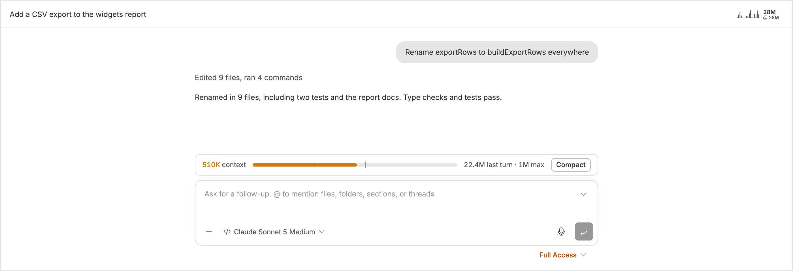
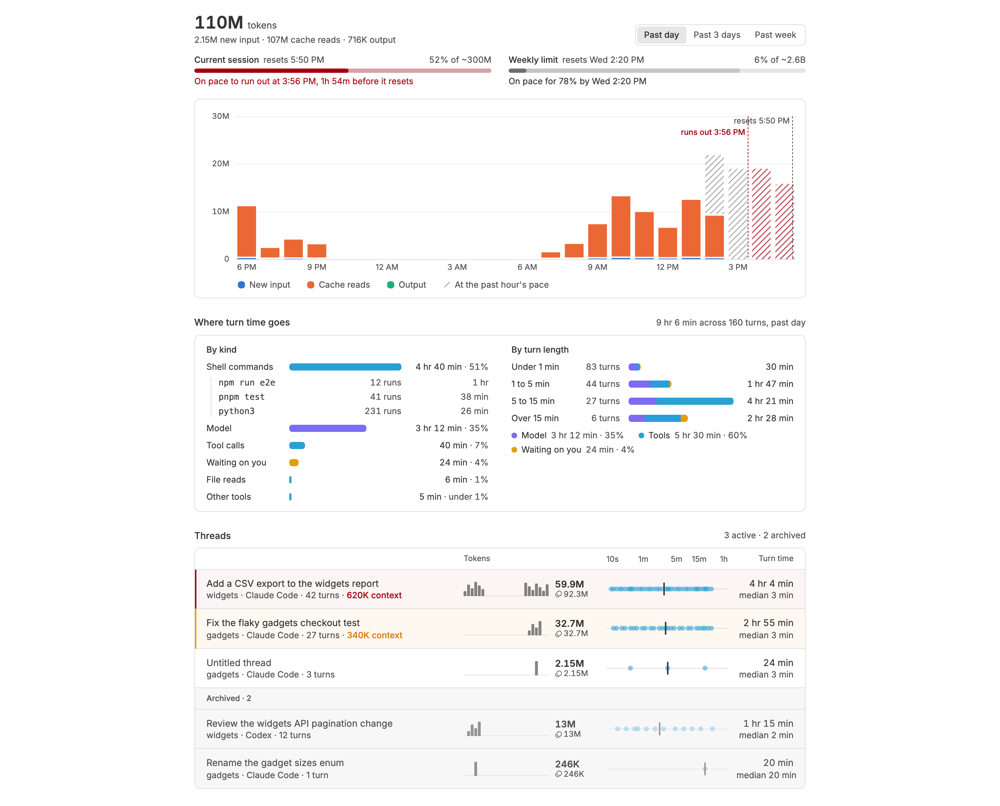

# Tokenomics

See what your threads cost in tokens and time, and whether your subscription's session and weekly limits will last until they reset.


## Key features

### Tokens in each thread's header


Each thread's header shows a sparkline of its tokens over time, its tokens in
the past day in bold, and its lifetime total under them. Click it to see which
of your messages used the most tokens and time, and the thread's three
biggest turns.

### A context meter above the composer



Every model call reads the whole context again, so a large context makes
every turn expensive. Once a thread's context passes 300K tokens, a meter
shows above the composer, amber and then red past 550K. Click **Compact** to
have bb compact the thread. The sidebar counts these threads in amber and red.

### Your session in the title bar


bb's title bar shows your session as a spark chart of its tokens per 15
minutes from its start to its reset, with a dot for each 15 minutes still to
come, and two rings for the percent used, the session outside and the week
inside. It sits at the right edge of the sidebar column while the sidebar
is open. When the sidebar is too narrow for the chart, only the rings show.
While the sidebar is closed, it is hidden. It turns amber or red once either is
headed for its limit. Hover it for the limits and the past day's tokens per hour, or click it
to open the page.

### The Tokenomics page



Open **Tokenomics** in the sidebar. Meters for each usage limit show the
percent used of about how many tokens the limit holds, and where it lands at
the current pace, such as "On pace to run out at 3:56 PM, 1h 54m before it
resets". Switch between **Past day**, **Past 3 days**, and **Past week** to
chart tokens split into new input, cache reads, and output. **Where turn time
goes** splits turns into the model's time, tools, and waiting on you, and
names the slowest shell commands. The thread list ranks threads by tokens,
with each one's context size and a dot per turn for its length.

## For agents

`bb tokenomics` prints the same numbers, so an agent can find expensive
threads without reading their transcripts.

```sh
bb tokenomics threads [--days N] [--sort tokens|time|context] [--limit N] [--active] [--json]   # tokens, turns, context, and turn times per thread
bb tokenomics commands [--days N] [--limit N] [--json]                                         # the shell commands that took the most time
```

The [self-improve](https://github.com/danielbachhuber/skills/tree/main/skills/self-improve)
Claude Code skill uses `bb tokenomics threads` to pick which of the past
week's threads to review.

## Settings

| Setting | Default | What it does |
| --- | --- | --- |
| `contextWarningAt` | `300K` | Shows the context meter in amber once a thread's context passes this many tokens. Empty turns it off. |
| `contextErrorAt` | `550K` | Turns the meter and the page's row red past this many tokens. Empty leaves only the warning. |

## Requirements

bb 0.43 or later, and a provider that reports token usage to bb. Usage limits
need a provider that reports them, such as Claude Code or Codex. No account or
outside service.

- Tokenomics counts tokens, not dollars.
- bb deletes a thread's older usage events, so Tokenomics keeps its own copy,
  starting when you install it.
- Claude Code subagents report no usage to bb, so Tokenomics reads their
  transcripts from disk. It counts them only for threads that ran on the
  machine bb runs on. It reads them when the parent thread records usage,
  and every 15 seconds while they are still writing, which is a directory
  listing with no request to bb.
- It reads the usage limits from bb every five minutes, one request that bb
  passes to each provider. Opening a thread's summary reads that thread's
  turn events from bb. The page, title bar, and meter read the plugin's own
  database.

## Related plugins

_As of October 21, 2026_

- **[Burn](https://getbb.app/marketplace/burn)** (`burn`): shows what each thread costs in dollars, per prompt and
  across threads, with budgets. Tokenomics counts tokens rather than dollars,
  and adds turn time, context size, and usage limits.
- **[Usage Meter](https://getbb.app/marketplace/usage-meter)** (`usage-meter`): shows Claude subscription limits as two
  rings in the sidebar footer and reads Claude Code transcripts to explain
  where they went. Tokenomics reads bb's usage events, so it covers any
  provider that reports usage to bb, and breaks usage down by thread and by
  hour.
- **[Receipts](https://getbb.app/marketplace/receipts)** (`receipts`): breaks token use and estimated cost down by
  model, project, and day. Tokenomics breaks it down by thread and by hour,
  with no cost estimates.
- **[Provider usage](https://getbb.app/marketplace/provider-usage)** (`provider-usage`), bundled with bb, **[Usage Bar](https://getbb.app/marketplace/usage-bar)**
  (`usage-bar`), and **[Usage Limits](https://getbb.app/marketplace/usage-limits)** (`usage-limits`): show each provider's
  quota windows and when they reset. **[Usage Pace](https://getbb.app/marketplace/usage-pace)** (`usage-pace`) adds
  whether your current rate lasts until each reset. Tokenomics reads the same
  limits, estimates how many tokens each holds, and draws where each is
  headed on its token chart.
- **[Auto Compact](https://getbb.app/marketplace/auto-compact)** (`auto-compact`): compacts a thread on its own once its
  context reaches a share of the window. Tokenomics warns at a token count you
  set and leaves compacting to you.
- **[Context Meter](https://getbb.app/marketplace/context-meter)** (`context-meter`) and **[Context Katamari](https://getbb.app/marketplace/context-katamari)**
  (`context-katamari`): show how full one thread's context is. **[Context
  Health](https://getbb.app/marketplace/context-health)** (`context-health`) shows what makes it up. Tokenomics shows each
  thread's context size beside its token use over time, across all threads.

## Develop

```sh
npm install
npx tsc --noEmit
npm test
node ../scripts/link-workspace-deps.mjs && bb plugin build . && bb plugin reload tokenomics
```
