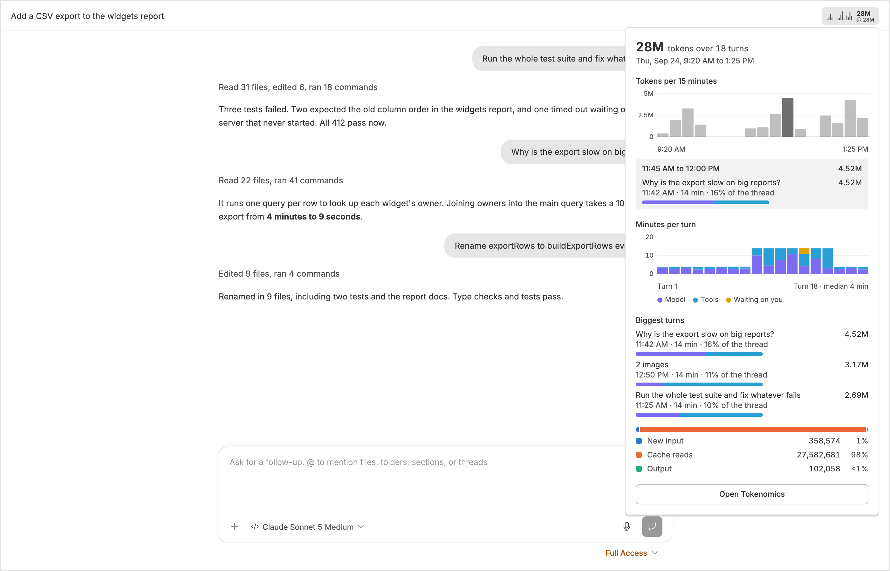
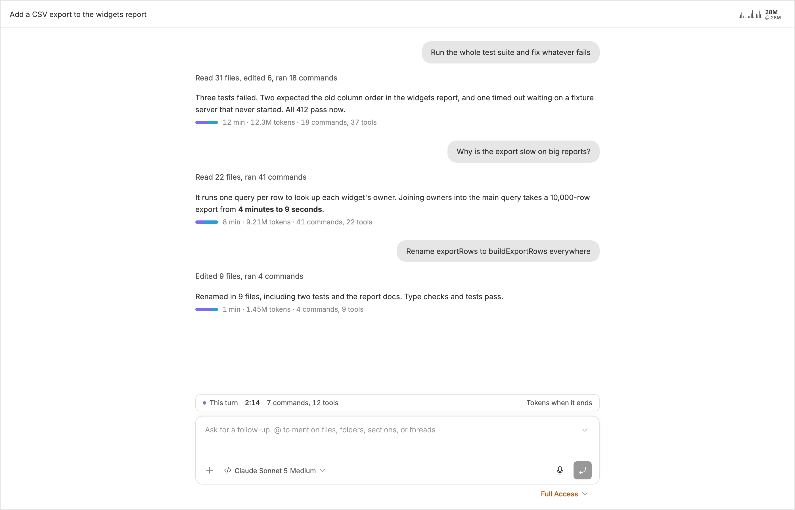
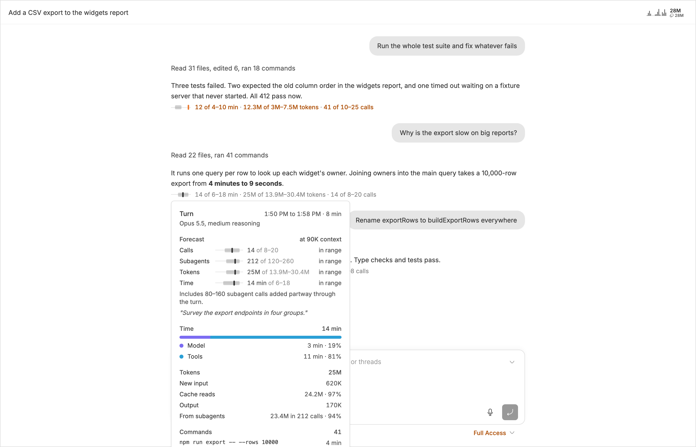
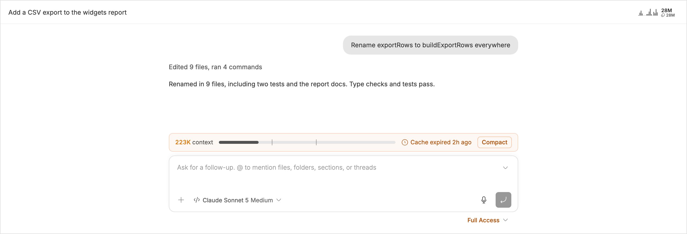
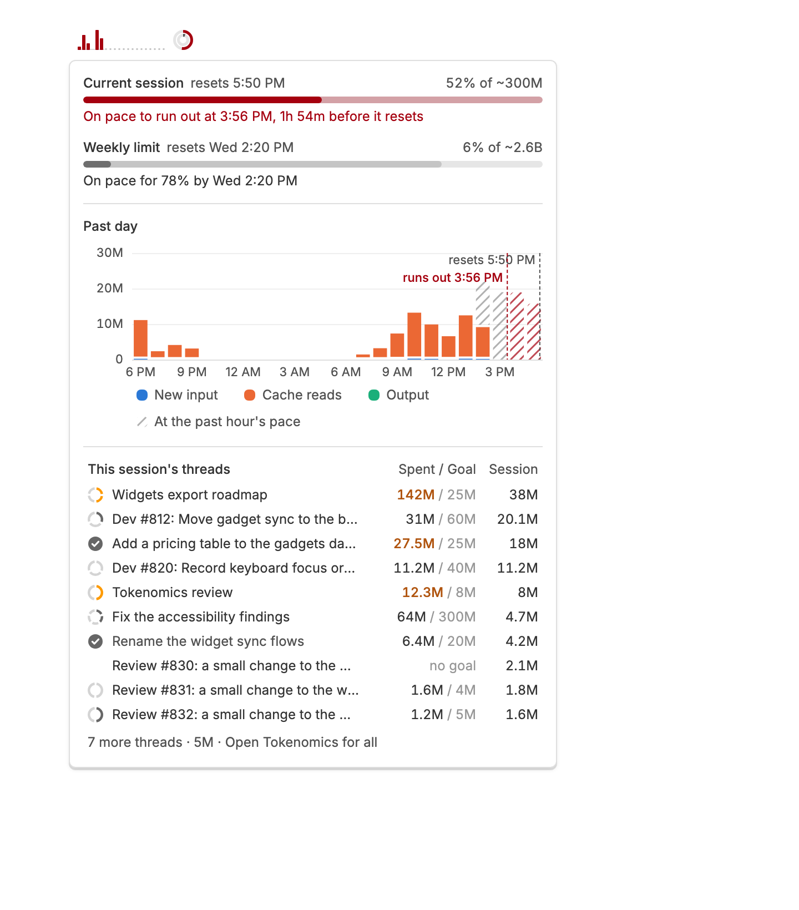

# Tokenomics

See what threads cost in tokens and time, each thread's goal, turns against forecasts, if limits last, and be asked before costly turns.


## Key features

### Tokens in each thread's header



Each thread's header shows a sparkline of its tokens over time, its tokens in
the past day in bold, and its lifetime total under them. Click it to see which
of your messages used the most tokens and time, and the thread's three
biggest turns.

### Each turn's time, tokens, and commands



Under each finished turn, a line shows how long it took, its tokens, and the
commands and other tools it ran. Above the composer, a strip counts the
running turn while it runs; its tokens arrive when it ends. bb has no plugin
slot under a turn, so the lines read bb's page markup and stop appearing if
bb changes it. Both read Tokenomics' own database, with no calls to bb.

### Claude's forecast for each turn


Claude forecasts each turn that uses a tool with `bb tokenomics forecast`: an
80% range of model calls, plus any wait it knows of, run alongside its first
command so it costs no extra call. Minutes follow from calls at the thread's
own time per call, and tokens from calls, the context, and how fast the
context has been growing. The line
under the turn shows each number against its range, amber when over and blue
when under, and the strip above the composer counts calls against the range
while the turn runs, turning amber once it passes. The turn's card names its
model, fast mode, and reasoning level. Claude counts the calls of the
subagents it plans to start too, priced at what a subagent call cost and took
across the past week's subagents, and adds calls when it decides on
subagents partway through. The card shows the subagents' calls against their
range and how many of the turn's tokens they used. Each forecast prints Claude's recent
record for turns with the same settings, so its next range can move. When
the thread has a goal, it also lists the entries still open and the command
that marks them, so Claude keeps marking them after a compaction or a run of
turns that each start from a button.

### A check before costly turns



When a turn's forecast, its subagents included, could pass **Ask before turns
over** (10M tokens unless you change it), `bb tokenomics forecast` tells Claude
to stop and ask you first. The question gives the range, its share of your
current session, and what the tokens would go to. Once you say to go ahead,
Claude forecasts with `--confirmed` and carries on.

### Each thread's goal


Each thread records one goal: what the whole thread is for, not its next
step. In its first turn Claude records it with `bb tokenomics goal set`, from
the brief a plugin or another thread wrote, or from your first prompt, and
says so in one line instead of asking. When it can't tell yet what finished
looks like, such as before you approve a plan, it suggests a goal instead.
With Impromptu UI installed, the suggestion is a question above the composer:
the goal, its "Done is" list and estimate, and a Set this goal button. A task gets a "Done is" list of end
states such as "Tests pass" rather than steps, the last one what ends the
thread, such as "PR open with checks passing", each marked in progress, done,
or dropped as the work goes. The goal's detail level caps the list: up to 5
entries at low, the default, or 25 at high. When the work has more pieces
than that, such as a review's 17 findings at low detail, Claude groups them
and keeps a count on each group, such as "Medium findings addressed · 2 of
9", rather than tracking each one. An exploration gets the question it
answers; a conversation can have no goal.

The goal's donut leads the token button in the thread header, before the
sparkline. The summary that button opens starts with the goal: how far it has
come, a square and name for each entry (the donut's segments), with any
count, showing which are done, in progress, or still to do, and what the goal
has used against Claude's estimate of its turns, tokens, and minutes. In the
sidebar, a segmented donut at the right
end of the row takes the place of bb's own icon: it has a segment per entry,
filled when done and lighter when dropped. A grouped entry's segment is as
long as the items it counts and fills by its count, so 30 issues in groups of
9, 14, and 7 with 9 fixed fill about a third of the ring, and the goal's
count reads "9 of 30" in the summary and the sidebar label rather than "0 of 3". It turns amber past the estimate, and becomes a check once met. bb's
states show on it: the done arc turns blue when the thread needs you,
including when an Impromptu UI card above its composer still waits on your
answer, and darker when it finished and you haven't looked; the
whole donut spins while the thread works; a draft keeps bb's own icon. A
failed turn, including one bb will retry after a provider error, shows bb's
icon alone, without the donut; a plain queued message keeps the donut. The
header donut and the cards say the same. An exploration's entries are fixed:
the agent's recommended answer, then your decision. Rest on a sidebar donut
for the goal's card. When setting a
goal, Claude sees how past threads that started the same way went, from a
plugin's button, another thread, or neither. Run `/tokenomics-update-goal`, with a goal
and a level of detail (high or low) after it or not, to set or update the
goal: it uses the goal you give or drafts one from the thread's work, records
it without asking, and keeps the old goal, and what it used, in the thread's
history. When you name a different end result, it closes the old goal and
starts a new one; when the end result is the same, it refines the list and
keeps the entries the new goal still needs, with their progress. It asks only
when unfinished entries may or may not still belong. `/tokenomics-clear-goal` takes the goal off the
thread, keeping it in the history too. When the work is
done, Claude closes the goal as met, partly met, or not met. Work you review,
such as a design, ends with your acceptance as its last entry, and feedback
that arrives after the goal closed reopens it. A closed goal keeps counting the
thread's turns until another goal replaces it, so follow-up work after the
close counts toward the outcome.

The sidebar donut goes into bb's own markup, since bb has no slot for it. If
bb changes that markup the donuts stop appearing, and nothing else breaks.

### A context meter above the composer


Every model call reads the whole context again, so a large context makes
every turn expensive. Once a thread's context passes 300K tokens, a meter
shows above the composer, amber and then red past 550K. Click **Compact** to
have bb compact the thread. The sidebar counts these threads in amber and red.



The meter also shows, tinted amber, once a thread of 100K tokens or more has
sat idle past its prompt cache, usually an hour for Claude Code. Its next
message would read the whole context again uncached, so that is the moment
to **Compact**. This is the same rule as bb's **Compact before resuming
expired sessions** experiment, which offers to compact as you send. With
both on, both show.

### Your session in the title bar


bb's title bar shows your session as a spark chart of its tokens per 15
minutes from its start to its reset, with a dot for each 15 minutes still to
come, and two rings for the percent used, the session outside and the week
inside. Between sessions, when the provider reports no session, it shows
the week's ring and the past five hours' tokens instead. It sits at the right edge of the sidebar column while the sidebar
is open. When the sidebar is too narrow for the chart, only the rings show.
While the sidebar is closed, it is hidden. It turns amber or red once either is
headed for its limit. Hover it for the limits and the past day's tokens per hour, or click it
to open the page.



Below the chart, the popover lists the session's ten threads that used the
most tokens, subagents included, most first. Each row shows the thread's
goal donut, **Spent / Goal**: what its current goal has used against the top
of the goal's token estimate, amber once past it, and the thread's tokens this
**Session**. Click a row to open the thread.
Opening the popover makes one query to Tokenomics' own database, and no call
to a provider.

### The Tokenomics page


Open **Tokenomics** in the sidebar. Meters for each usage limit show the
percent used of about how many tokens the limit holds, and where it lands at
the current pace, such as "On pace to run out at 3:56 PM, 1h 54m before it
resets". When a limit starts counting again partway through a window, as
after a plan change, its pace and size use only the readings since then. Switch between **Past day**, **Past 3 days**, and **Past week** to
chart tokens split into new input, cache reads, and output. **Where turn time
goes** splits turns into the model's time, tools, and waiting on you, and
names the slowest shell commands. The thread list ranks threads by tokens,
with each one's context size and a dot per turn for its length. **Goals**
shows the past 30 days: how many goals were met, partly met, and not met and
what each took, how often goal estimates held, and archived threads with a
goal against without, by how they started.

## For agents

`bb tokenomics` prints the same numbers, so an agent can find expensive
threads without reading their transcripts.

```sh
bb tokenomics threads [--days N] [--sort tokens|time|context] [--limit N] [--active] [--json]   # tokens and their cost, turns, context, and turn times per thread
bb tokenomics accounts [--days N] [--json]                                                     # tokens per day for each account, with its weekly limit
bb tokenomics commands [--days N] [--limit N] [--json]                                         # the shell commands that took the most time
bb tokenomics forecast --calls LOW-HIGH [--subagent-calls LOW-HIGH] [--wait-minutes LOW-HIGH] [--confirmed] [--note TEXT]  # record this turn's forecast
bb tokenomics forecast --add-subagent-calls LOW-HIGH [--confirmed]                              # add subagents decided on partway through
bb tokenomics forecasts [--days N] [--json]                                                    # past forecasts against what each turn took
bb tokenomics goal set "GOAL" --stage "END STATE" ... [--detail low|high] [--turns 3-8 ...]          # record this thread's goal
bb tokenomics goal stage next|N                                                                # mark the next entry, or the first N, done
bb tokenomics goal estimate [--turns ...] [--tokens ...] [--minutes ...]                         # replace the estimate
bb tokenomics goal close met|partly|not [--note TEXT]                                            # record how it ended
bb tokenomics goal refine ["GOAL"] [--stage ...] [--detail ...] [--reached N] --reason TEXT    # bring the open goal up to date, keeping progress
bb tokenomics goal entry add "END STATE" ... | start|done|drop|todo N ...                        # add entries, or mark them by number
bb tokenomics goal entry count N DONE/TOTAL                                                      # a grouped entry's count, such as 2/9
bb tokenomics goal reopen [--stage "END STATE"] ...                                              # open a closed goal again, such as for feedback
bb tokenomics goal clear [--reason TEXT]                                                         # take the goal off the thread, keeping it in the history
bb tokenomics goal show [--json]                                                               # the goal, its list, what it has used, and each change with its time
bb tokenomics improvements collect [--days N | --since TIME] [--thread ID ...] [--budget COST]  # digests of the costliest threads for the find-improvements reviewers
bb tokenomics improvements price|view|summary FINDINGS.json                                    # price findings, build their cards, or print the run's summary
```

The plugin ships the `tokenomics-update-goal` skill, which uses the goal you give
it or drafts one from the thread, replaces or refines the current goal depending on
whether the end result changed, records it without asking unless unfinished
entries may no longer belong, and says in one line what the goal is now; and the
`tokenomics-clear-goal` skill, which takes the goal off the thread with
`goal clear`.

The `tokenomics-find-improvements` skill looks for where threads used tokens
they did not need. `collect` picks the costliest threads in a period, as many
as a budget (2M input-equivalent tokens by default) pays reviewers for, and
writes a digest of each: every turn's calls with where each model response
starts, the outputs later calls kept re-reading, cache health, and each
project's starting prompt. Reviewer subagents read the digests and a research
subagent looks for recent practices that cut tokens. Each finding names the
file to change, such as a script in the repository, a skill, or an
instruction, and `price` prices it from the turns it would have removed. The
findings show as Impromptu UI cards with **Open issue** and **Start PR
thread**, and the run ends with a summary of what it analyzed and what the
fixes would save. `collect` reads Tokenomics' database and each selected
thread's event log once; it makes no other API calls.

## Settings

| Setting | Default | What it does |
| --- | --- | --- |
| `contextWarningAt` | `300K` | Shows the context meter in amber once a thread's context passes this many tokens. Empty turns it off. |
| `confirmTurnsOver` | `10M` | Has Claude stop and ask before a turn whose forecast could pass this many tokens. Empty never asks. |
| `forecastTurns` | on | Adds about 350 tokens to each thread's instructions asking Claude to forecast each turn. Off stops new forecasts. |
| `contextErrorAt` | `550K` | Turns the meter and the page's row red past this many tokens. Empty leaves only the warning. |
| `setGoals` | on | Adds about 450 tokens to each thread's instructions asking Claude to record, move, and close the thread's goal. Off stops new goals. |
| `goalLine` | on | Shows the goal's donut on the thread header's token button, and the goal at the top of the summary it opens. Off removes them from open threads right away. |
| `goalSidebar` | on | Shows the goal donut in sidebar rows. Off removes them right away. |
| `costWeights` | empty | JSON of what each kind of token costs against fresh input, by provider, for the cost `bb tokenomics threads` reports. Claude Code counts cache reads as 0.1, cache writes as 1.25 (2 with an hour-long cache), and output as 5; other providers count every token as 1 until set here, such as `{"codex": {"cacheRead": 0.1, "output": 4}}`. |

## Requirements

bb 0.43 or later, and a provider that reports token usage to bb. Usage limits
need a provider that reports them, such as Claude Code or Codex. No account or
outside service.

- Tokenomics counts tokens, not dollars. Its cost is in input-equivalent tokens: each kind of token weighted by its price against fresh input. Cache writes are stored apart from uncached input from this version on; on Claude Code, older rows count their fresh input as cache writes.
- It counts a turn's model calls from the context bb records after each response, and keeps each forecast, about 100 bytes, with the thread's other rows.
- It keeps each goal, and each earlier goal a revision replaced, with what it
  used, a few hundred bytes each, and a timed log of every change to them
  (entries marked, estimates changed, closes, reopens), about 150 bytes a
  change, and deletes both when bb deletes the thread. The token button reads one goal from the plugin's database
  when the thread opens and after each turn; the sidebar reads every active
  thread's goal in one request after each recorded usage and once a minute.
  The token button doesn't ask bb. Each of those sidebar requests also asks
  Impromptu UI, when it is installed, which threads have an open card, and bb
  which of those threads failed, one local call each.
- bb deletes a thread's older usage events, so Tokenomics keeps its own copy,
  starting when you install it.
- Claude Code subagents report no usage to bb, so Tokenomics reads their
  transcripts from disk. It counts them only for threads that ran on the
  machine bb runs on. It reads them when the parent thread records usage,
  and every 15 seconds while they are still writing, which is a directory
  listing with no request to bb.
- It reads the usage limits from bb every five minutes, one request that bb
  passes to each provider. When you sign in to another account, the limits
  switch to it at the next reading. Tokens count toward an account only while
  it was signed in. Each recorded call is stamped with its account at the
  next reading, so `bb tokenomics accounts` can split tokens by account after
  the readings are deleted nine days later. Calls from before Tokenomics read
  an account show as not known. A window that began before bb first saw the account
  shows "sizing the limit" until it resets, since its percent includes use
  bb didn't record. Opening a thread's summary reads that thread's
  turn events from bb. The page, title bar, and meter read the plugin's own
  database.

## Related plugins

_As of November 18, 2026_

- **[Burn](https://getbb.app/marketplace/burn)** (`burn`): shows what each thread costs in dollars, per prompt and
  across threads, with budgets. Tokenomics counts tokens rather than dollars,
  and adds turn time, context size, and usage limits.
- **[Usage Meter](https://getbb.app/marketplace/usage-meter)** (`usage-meter`): shows Claude subscription limits as two
  rings in the sidebar footer and reads Claude Code transcripts to explain
  where they went. Tokenomics reads bb's usage events, so it covers any
  provider that reports usage to bb, and breaks usage down by thread and by
  hour.
- **[Receipts](https://getbb.app/marketplace/receipts)** (`receipts`): breaks token use and estimated cost down by
  model, project, and day. Tokenomics breaks it down by thread and by hour,
  with no cost estimates.
- **[Provider usage](https://getbb.app/marketplace/provider-usage)** (`provider-usage`), bundled with bb, **[Usage Bar](https://getbb.app/marketplace/usage-bar)**
  (`usage-bar`), and **[Usage Limits](https://getbb.app/marketplace/usage-limits)** (`usage-limits`): show each provider's
  quota windows and when they reset. **[Usage Pace](https://getbb.app/marketplace/usage-pace)** (`usage-pace`) adds
  whether your current rate lasts until each reset. Tokenomics reads the same
  limits, estimates how many tokens each holds, and draws where each is
  headed on its token chart.
- **[Auto Compact](https://getbb.app/marketplace/auto-compact)** (`auto-compact`): compacts a thread on its own once its
  context reaches a share of the window. Tokenomics warns at a token count you
  set and leaves compacting to you.
- **[Cache Watch](https://getbb.app/marketplace/cache-watch)** (`cache-watch`): shows how much
  prompt cache each turn reuses, the time left before it expires, and an
  optional keepalive that sends turns to keep it warm. Tokenomics only says
  once an idle thread's cache has expired, and offers to compact.
- **[Context Meter](https://getbb.app/marketplace/context-meter)** (`context-meter`) and **[Context Katamari](https://getbb.app/marketplace/context-katamari)**
  (`context-katamari`): show how full one thread's context is. **[Context
  Health](https://getbb.app/marketplace/context-health)** (`context-health`) shows what makes it up. Tokenomics shows each
  thread's context size beside its token use over time, across all threads.

- **[UltraGoal](https://getbb.app/marketplace/ultragoal)** (`ultragoal`) and **[Loom](https://getbb.app/marketplace/loom)** (`loom`): take a goal
  and run it across workers, with plans, tickets, and verifiers. Tokenomics
  only records each thread's goal, shows its progress, and counts what it cost.
- **[Plan Progress](https://getbb.app/marketplace/plan-progress)** (`plan-progress`): follows the agent's plan above the
  message box, step by step. Tokenomics shows the goal and its "Done is"
  list of end states, never the step list.
- **[Radar Sidebar](https://getbb.app/marketplace/radar-sidebar)** (`radar-sidebar`): replaces the sidebar, groups
  threads by activity, and previews goals on hover. Tokenomics leaves bb's
  sidebar in place and adds a mark beside each row.
- bb's own thread goal, for Codex threads, keeps an objective and a token
  budget per thread. Tokenomics records goals for any provider, with a "Done is" list,
  an estimate, and an outcome.

## Develop

```sh
npm install
npx tsc --noEmit
npm test
node ../scripts/link-workspace-deps.mjs && bb plugin build . && bb plugin reload tokenomics
```
